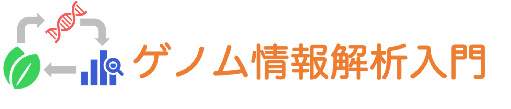

<a href="https://github.com/CropEvol/lecture#section2">実習表ページに戻る</a>

# 講義へのご意見・ご質問

Q) 倍数体の植物では、似た配列を持つ複数の染色体をどのように区別してアセンブルするのでしょうか？

> 倍数体のアセンブルは、ゲノムアセンブルの中でも特に難しい問題の1つです。
> 基本的にはわずかな違いを手がかりにします。似た染色体どうしでも、まったく同じではなく、ところどころにSNPや挿入・欠失などの違いがあります。アセンブルでは、このわずかな違いを手がかりに、リードをどの染色体由来かに振り分けます。
> 特に、同質倍数体（例: 栽培ジャガイモ、アルファルファ、サトウキビ）は、同じ種のゲノムが倍になったもので、染色体の違いは、品種内の個体差程度しかなく、かなり区別が難しくなります。
> 倍数体ゲノムの構築は、長くて正確なリード（HiFi）や、Hi-C や両親のゲノムといった別の情報を組み合わせることで近年ようやく現実的になってきました。

---

Q) 	k-merの長さをいろいろと変えてアセンブル結果を比べていましたが、k-merを短くするメリットはあるのでしょうか？

> 短いk-merと長いk-merにはそれぞれメリットとデメリットがあります。
> 短い k：リードが少ない場所やエラーに強い。ただし、リピートで切れやすい
> 長い k：リピートを乗り越えやすい。ただし、リードが少ない場所やエラーで切れやすい
> そこで SPAdes などのアセンブラは、1つの k に決めずに、リード長に応じて複数の k を自動で選び（例: 21, 33, 55…）、組み合わせて使います。まず短い k でリードの少ない場所をつないでおき、次に長い k でリピートの部分を整理していく、という使い分けです。

---

Q) 元のゲノム配列が分かっていない場合は、どのようにしてエラーが起こっているかどうかを判定するのか疑問に思いました。また、そもそも元のゲノム配列が正しいかどうかはどうやって分かるのでしょうか。

> たしかに実際の研究では正解がないのが普通です。
> ある領域のゲノム配列は1度だけシーケンスされる訳ではありません、その部分を読んだリードが何本も出てきます。
> それら全てが共通の配列の場合は正しい配列である可能性が高いです。
> また、公開されているゲノム配列が正しいとは限りません。
> 公開されている配列も研究者が作成し、できる限り検証したものです。そのため、誤りや配列のわからない部分を含んでいて、ヒトゲノムの例で説明したように、新しい技術が出るたびに改訂されています。

---

Q) 	ショートリードでも解析可能な最大の繰り返し数がいくつまでなのかは分かっているのですか？

> 繰り返し配列の長さによります。10bpの繰り返しが5回、などであれば150bpのショートリードでカバー可能ですが、
> 30bpの繰り返しが10回、の場合は150bpの範囲を超えてしまうので解析できません。

---

Q) 実際の研究においてシーケンシングで得られたリードをアセンブルするときもpythonなどを用いて、自分でコードを書いて、ゲノム配列を再構築するのですか？

> 基本的には既に確立されたプログラムを使用する場合が多いです。
> プログラムを組み合わせたりする部分や、出てきた結果を編集する所は自分でプログラムを組むこともあります。

---

Q) コードを動かして何ができているのか理解できていないままですが、RやPythonは慣れていくうちに自分が何をしているのか分かるようになるのか不安です。

> 本講義では、こちらで提供しているRやPythonのコード、コマンド等の中身は理解しなくても大丈夫です。
> 「各ステップでどういうデータを入力するとどんな結果が得られるのか」が分かればOKです。
> どの様な計算を行ったりどの様なプログラムを使っているかの部分は日々新しいものが出てくるからです。