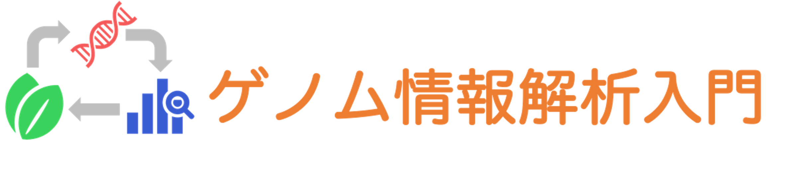

<a href="https://github.com/CropEvol/lecture#section2">実習表ページに戻る</a>

# 講義へのご意見・ご質問

Q) ひとつ前の問題１について解説をしてくださるとありがたいです。
Q) 課題の質問があまりよく理解できていません。値が極端だとホモ結合の可能性が高く、中央値に近いとヘテロ結合になるところを解説してもらえると嬉しいです。

> 後で講義中に説明します。

---

Q) シーケンス費用が下がった現在でも、実際の研究ではまず極端な個体群だけに絞って読むことが多いのでしょうか、それとも最初から全個体を個別に読む手法へ移行しつつあるのでしょうか？

> 費用にもよりますが、一番はシーケンスデータを用いてどんな解析を実施するかによります。
> 形質と関連する変異を探す目的であれば、紹介したバルクシーケンス等を活用することもありますし、
> 来週扱うGWASだったり、集団遺伝学的な解析を実施する場合は全個体を個別に読む必要があります。

---

Q) 「1-5. 形質と連関しているSNP箇所を探す」のところで、「Short」形質をもつF2個体を選ぶ際、実習テキストではF2個体番号を指定してアライメント結果をのデータを出力していましたが、形質が「Short」であるものを指定して、F2個体番号とアライメント結果のデータを出力することはできないのでしょうか。番号を手入力するのは人為的なミスを誘発しそうだと思いました。

> 講義で扱う都合上、色んなパターンを試す目的でやっているだけなので、実際の解析ではテキストの様なことはやりません。
> 実際の解析ではプログラム等組んでヒューマンエラーを出さず、再現性がある様に解析を進めます。

---

Q) 	倍数体の植物のサンプルから得た短い配列を、reference genome に多少のミスマッチを許容してアライメントするとき、注目するreference genome の箇所とは異なる染色体由来のサンプル配列が、誤ってアライメントされることがあるように思います。どんな対策がとられているのでしょうか。

> アラインメントのクオリティ等で絞ったり、ロングリードを用いて一意に場所が決まる確率を上げる、等色々対策はありますが、完全に分離する事は不可能です。一意に決まらなかった場合は省く等の対応をして解析を進める場合が殆どです。
> 今日の講義でリードデプスについて扱いますが、あまりにも大量のリードがアラインメントされている領域があった場合は、リピートや他染色体由来のものが誤ってアラインメントされた可能性が考えられたりします、あくまで可能性レベルですが。

---

Q) 	1-7 47行目のコードブロックで書き加えた error_rate は、シーケンシングエラーの起こる確率ですか？

> そうなります。シーケンス方法によっても変わりますが、概ね1~0.1%以下あたりになります。
